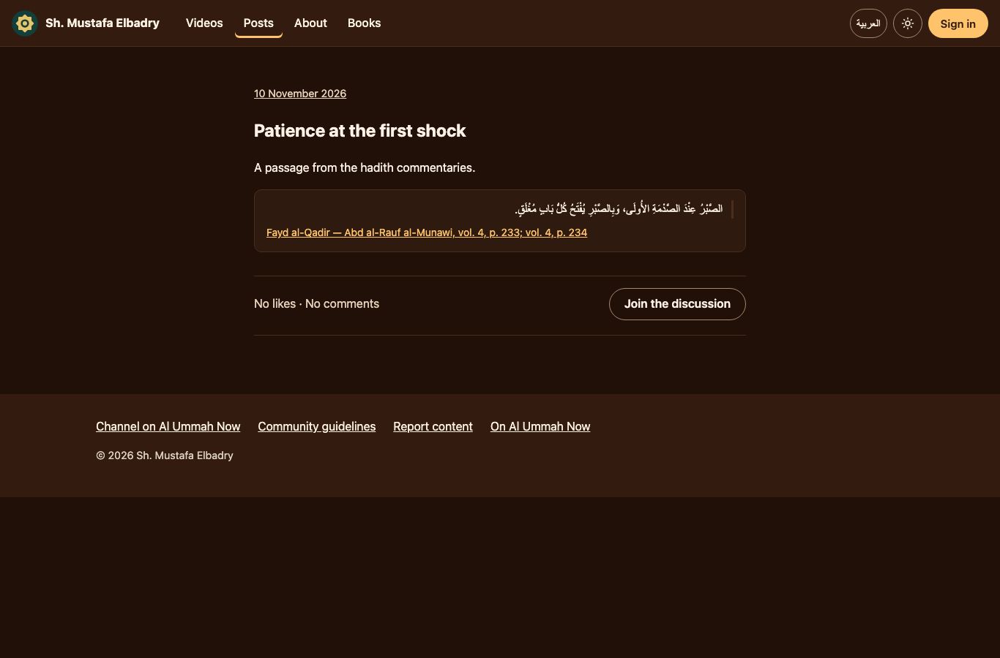
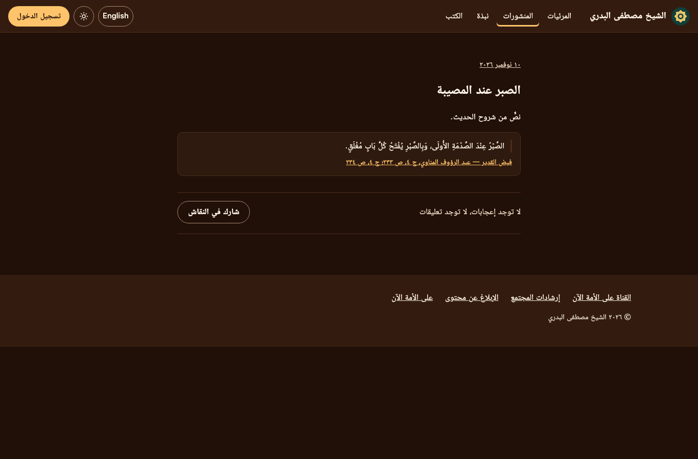

# Qaf quotations on scholar sites

Article and text posts display a Qaf quotation in an Arabic blockquote with a linked citation. The citation keeps the book, author, and every printed volume and page stored by Studio. Scholar articles and www use the same Markdown renderer.

The examples show a passage spanning two printed pages.

| English | العربية |
|---|---|
|  |  |
